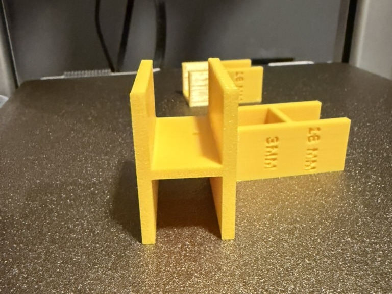
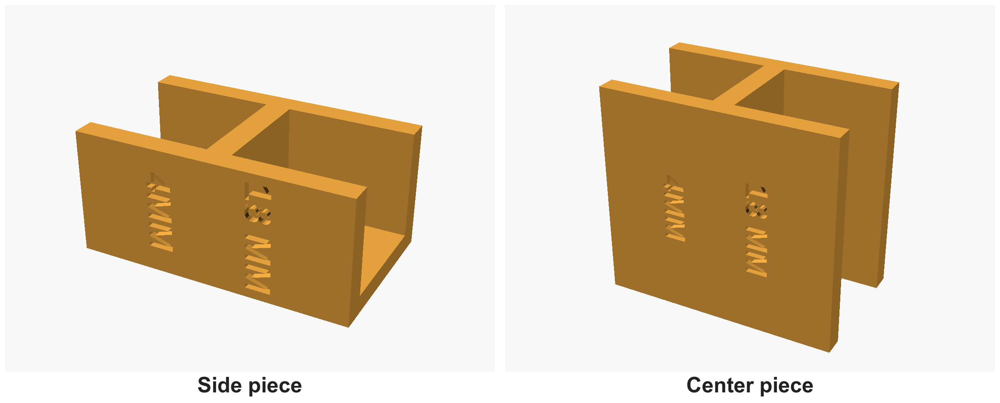

# drawer-front-spacer

Parametric drawer front spacer jig written in OpenSCAD. It keeps an even gap
between stacked drawer fronts while you install them. Single self-contained file,
no external libraries. All dimensions in millimetres.

**[Get it on MakerWorld](https://makerworld.com/en/models/3695410-customizable-drawer-front-spacer-jig)**
and use the *Customize* button to generate your own sizes in the browser.



## Pieces

| Piece | Quantity | Description |
|---|---|---|
| Side | 2 | H profile with a closed base that rests against the side edge of the fronts. The same part works on the left and on the right. |
| Center | 1 | Taller H profile with no base, for the middle of the fronts. |

Board thickness and front gap are engraved on both walls of every piece, and the
engraving follows the values you choose.



## Usage

Open `drawer_front_spacer.scad` in OpenSCAD, adjust the values in
`Window > Customizer`, render with F6 and export the STL.

Command line:

```bash
openscad -o spacers.stl --export-format binstl \
  -D 'part="all"' -D board_thickness=15 -D front_gap=3 \
  drawer_front_spacer.scad
```

The file also targets MakerWorld's Parametric Model Maker: upload the `.scad` to
get the *Customize* button on the listing.

## Parameters

| Parameter | Default | Description |
|---|---|---|
| `part` | `"all"` | `all` (2 side + 1 center), `side` or `center` |
| `board_thickness` | 18 | nominal board thickness |
| `front_gap` | 4 | gap between drawer fronts |
| `clearance` | 0.30 | total clearance added to the board thickness |
| `arm_length` | 20 | length of each arm, measured from the divider |
| `side_height` | 20 | height of the side piece, including the base |
| `center_height` | 40 | height of the center piece |
| `wall_thickness` | 3.65 | thickness of each wall |
| `base_thickness` | 3 | base thickness of the side piece |

## Listing images

```bash
tools/promo.sh
```

Requires `openscad` (manifold backend) and ImageMagick (`magick`).

## Credits

Inspired by
[Drawer front spacer 4mm melamine 18mm](https://makerworld.com/en/models/2950038-drawer-front-spacer-4mm-melamine-18mm)
on MakerWorld.

## License

MIT, see [LICENSE](LICENSE).
